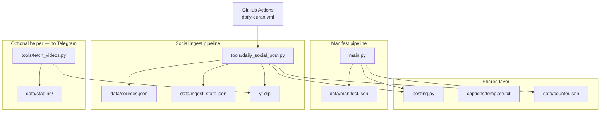
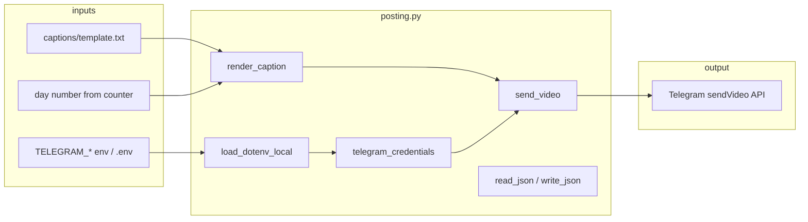
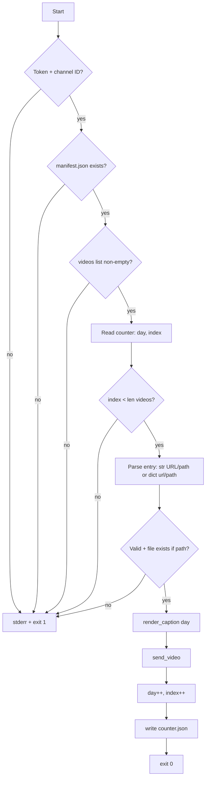
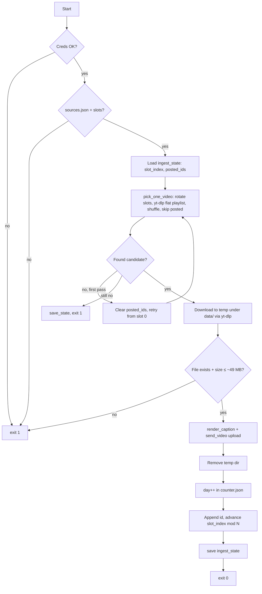
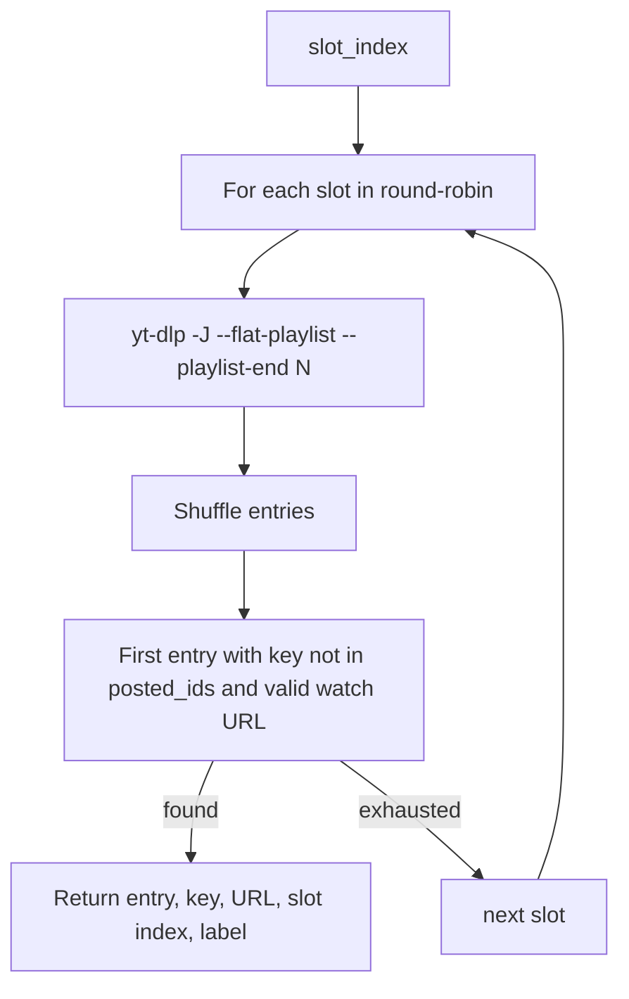
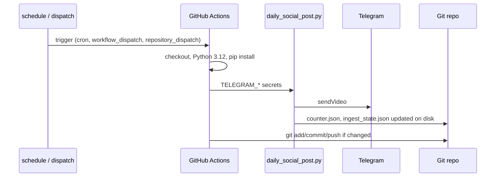
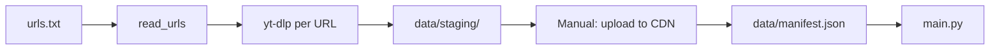
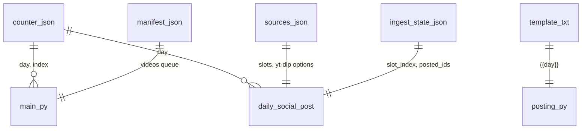

# Code flow (NSDA Quran bot)

This document describes how the project is structured, how data moves through it, and how the two posting modes relate. Diagrams use [Mermaid](https://mermaid.js.org/) (render in GitHub, VS Code preview, or any Mermaid-capable viewer).

---

## 1. Big picture

Two independent ways to post one video per run to Telegram; both share **`posting.py`** for credentials, captions, and `sendVideo`.

| Entry point | Primary data | Typical use |
|-------------|--------------|-------------|
| `main.py` | `manifest.json` + `counter.json` | Videos already at HTTPS URLs or local paths |
| `tools/daily_social_post.py` | `sources.json` + `ingest_state.json` + `counter.json` | Pull from creator URLs/playlists, download, upload to Telegram |
| `tools/fetch_videos.py` | URL list file → `data/staging/` | Build a library, then upload to CDN and switch to manifest mode |

---

## 2. Shared module: `posting.py`

- **`ROOT`**: directory containing `main.py` (used to resolve `data/`, `captions/`).
- **`render_caption(day)`**: replaces `{{day}}` in the template; caption is sent with HTML parse mode.
- **`send_video`**: exactly one of public **`video_url`** (Telegram fetches) or **`video_path`** (multipart upload). Timeouts differ (URL vs file).

---

## 3. Manifest pipeline: `main.py`

**Entry resolution**

- String entry: `http(s)://…` → URL; otherwise treated as path (relative to `ROOT` if not absolute).
- Dict entry: `url` or `path` (same path rules).

**State**: `counter.json` holds both **`day`** (caption) and **`index`** (position in `manifest.videos`).

---

## 4. Social ingest pipeline: `tools/daily_social_post.py`

This is what **GitHub Actions** runs by default (`python tools/daily_social_post.py`).

**`pick_one_video` (simplified)**

**Dedupe key**: `entry_key` → `extractor:id` (or best-effort from yt-dlp fields).

**State files**

- **`ingest_state.json`**: `slot_index`, `posted_ids` (trimmed to last 3000 IDs).
- **`counter.json`**: `day` incremented; `index` preserved if present (manifest compatibility).

---

## 5. CI/CD: `.github/workflows/daily-quran.yml`

Notes from the workflow comments:

- Scheduled runs are best-effort; external cron + `repository_dispatch` is documented for reliability.
- TikTok/Instagram may need cookies; local **Task Scheduler** is suggested when Actions fails.
- For **manifest-only** (no yt-dlp), the run step can be switched to `python main.py` and the yt-dlp install step removed.

---

## 6. Helper: `tools/fetch_videos.py`

No Telegram; batch download only.

---

## 7. Data file relationships

---

## 8. Dependency summary

| Component | Depends on |
|-----------|------------|
| `main.py` | `posting`, `manifest.json`, `counter.json` |
| `daily_social_post.py` | `posting`, `sources.json`, `ingest_state.json`, `counter.json`, yt-dlp |
| `fetch_videos.py` | yt-dlp only |
| `posting.py` | `requests`, optional `python-dotenv` |

---

*Generated for the nsda-quran-bot codebase. Adjust this file if entry points or workflow steps change.*
